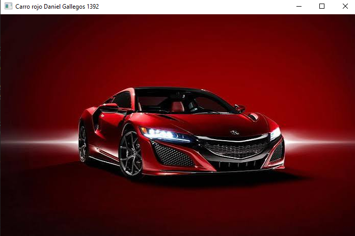
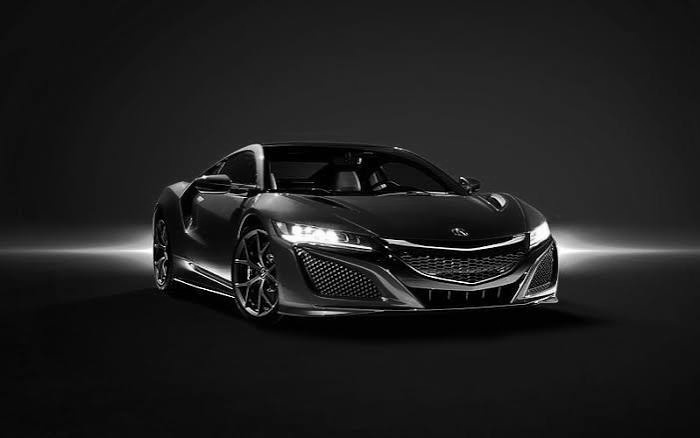
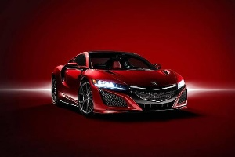
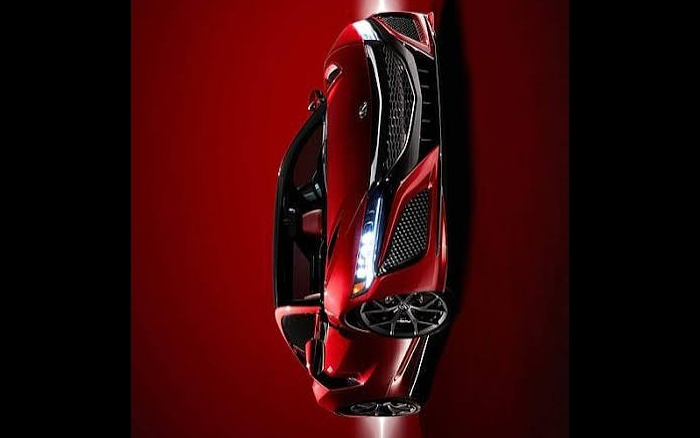
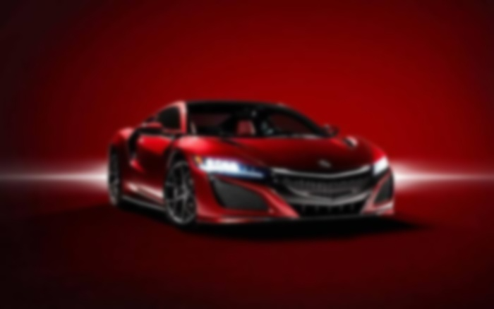
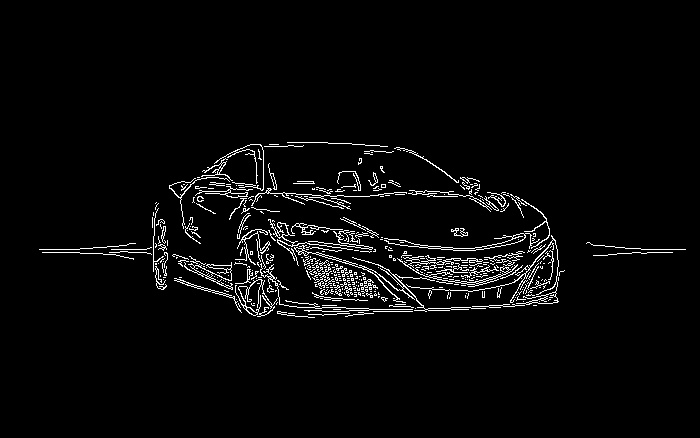
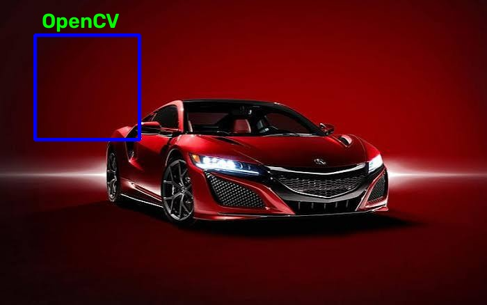
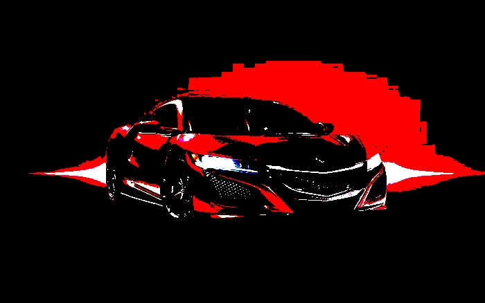
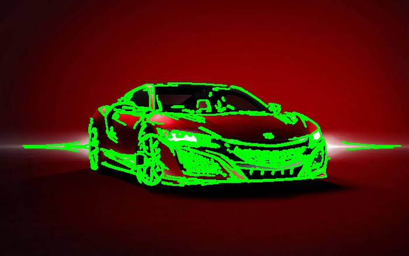

## Imagen Original

## Imagen en Escala de Grises

## Imagen Redimensionada

## Imagen Rotada

## Imagen Borrosa

## Bordes de la Imagen

## Colocar Cuadro Azul y Texto a la Imagen

## Umbralizacion de la Imagen

## Bordes de la Imagen
